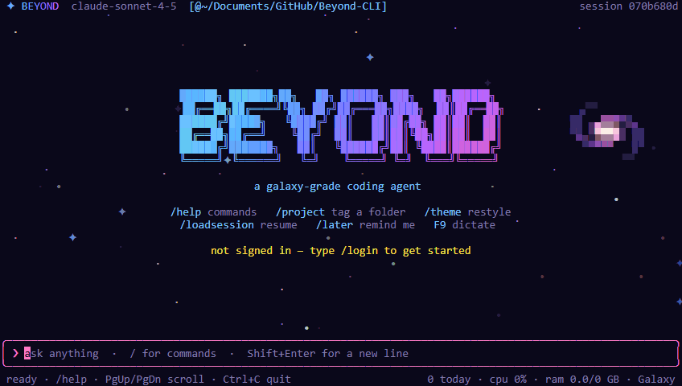
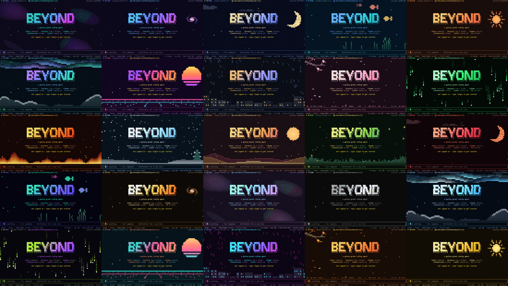

# Beyond-CLI
My personal Claude-Code CLI — fast, lightweight, galaxy-themed, written in Rust. Windows only for now.



## Install
Not published yet. Build it yourself:

```bash
cargo run
```

Or as an npm package: `cd npm`, `npm pack`, then `npm install -g ./beyond-cli-0.1.0.tgz` and run `beyond`.

## Signing in
If [Claude Code](https://code.claude.com) is installed and signed in, Beyond runs through it — nothing to set up.
Otherwise use an Anthropic API key: `/login key`.

## Themes
25 built in, each with an animated welcome scene. `/theme` opens a picker with live preview.



<details>
<summary>Make your own</summary>

A theme is a small JSON file loaded with `/loadtheme <file.json>`; anything left out comes from Galaxy.

```json
{ "name": "Mine", "accent": "#7c3aed", "gradient": ["#7c3aed", "#22d3ee"], "scene": "night" }
```

Scenes: `none` `nebula` `galaxy` `night` `ocean` `sun` `aurora` `retro` `city` `sakura` `code` `embers` `snow` `dunes` `fireflies`.
Animated GIFs of every theme are in `docs/themes/` (regenerate with `docs/make-previews.ps1`).
</details>

## Commands
Type `/help` in the app for the full list.

<details>
<summary>All commands</summary>

| Command | What it does |
|-|-|
| `/help [command]` | All commands and keys |
| `/theme [name]` | Switch theme |
| `/loadtheme <file.json>` | Load a custom theme |
| `/project [directory]` | Tag your project folder |
| `/env` | Detect toolchains and install what's missing |
| `/loadsession [id]` | Resume a Beyond or Claude Code session |
| `/later <when> <task>` | Remind me later |
| `/model [name]` | Pick the Claude model |
| `/mode [plan\|edits\|auto\|bypass]` | What Claude may do on its own |
| `/backend [auto\|claude\|api]` | Claude Code sign-in or API key |
| `/login [key]` · `/limitedlogin` · `/logout` | Sign in, 48-hour key, sign out |
| `/usage` · `/budget [tokens\|off]` | Tokens and cost, daily budget |
| `/window [cols rows\|off]` | Window size at launch |
| `/voice` or F9 | Dictate a message (experimental) |
| `/clear` · `/quit` | New conversation, exit |
</details>

## ExtraResources
Drop MCP servers (`.exe`, `.py`, `.js`) in `ExtraResources/MCPs/` and markdown skills in `ExtraResources/Skills/`; both load automatically.

## TODO
- [x] API keys, npm installer, 25 themes
- [ ] Speech-to-text — experimental, barely tested
- [ ] Agent todo lists and threads
- [ ] More Skills and MCPs
- [ ] Code clean-up
